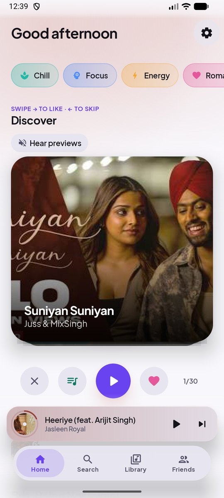
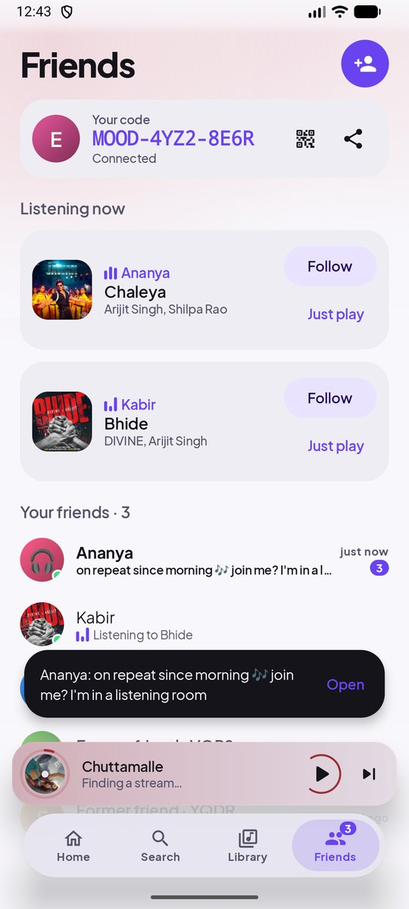
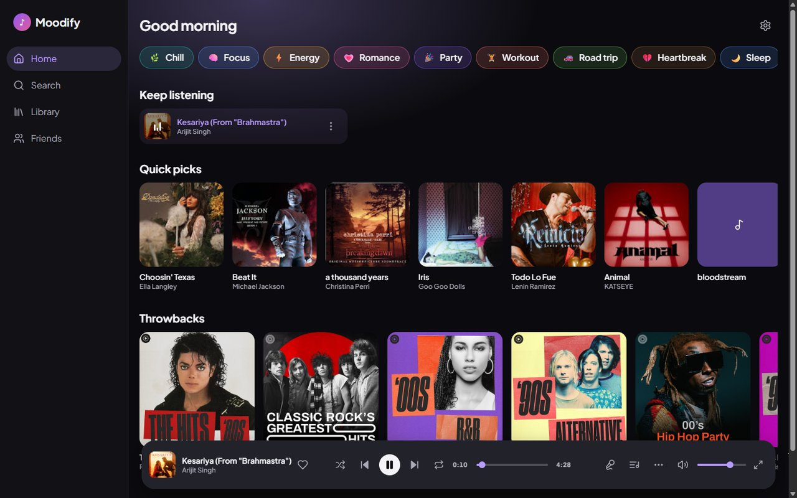
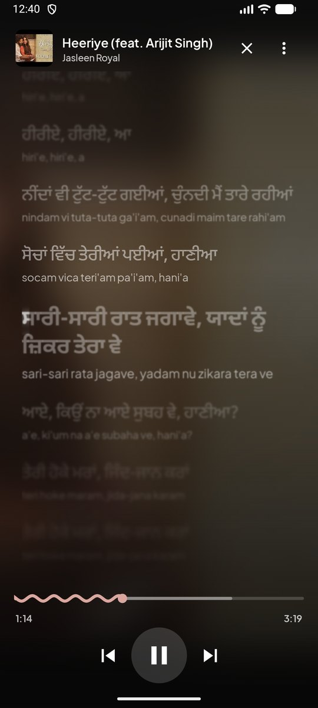
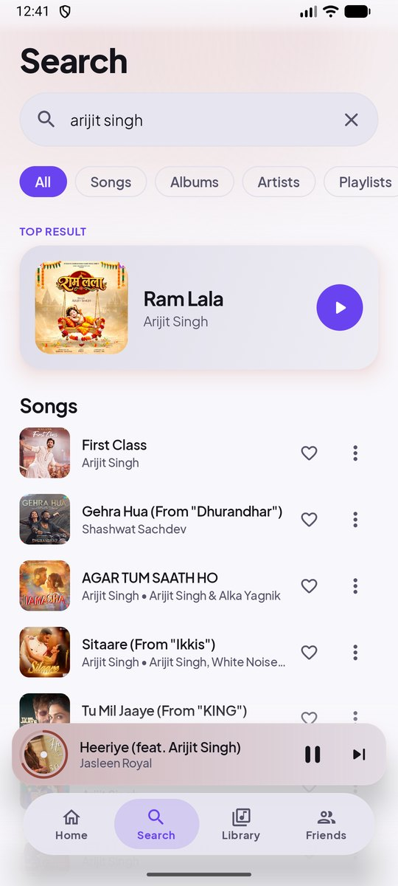
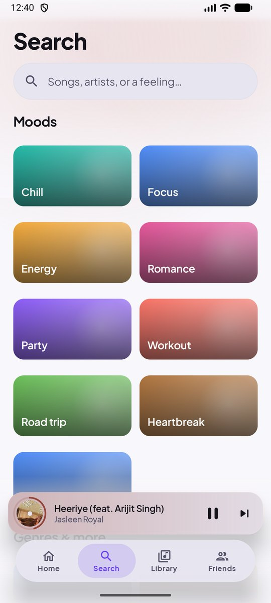
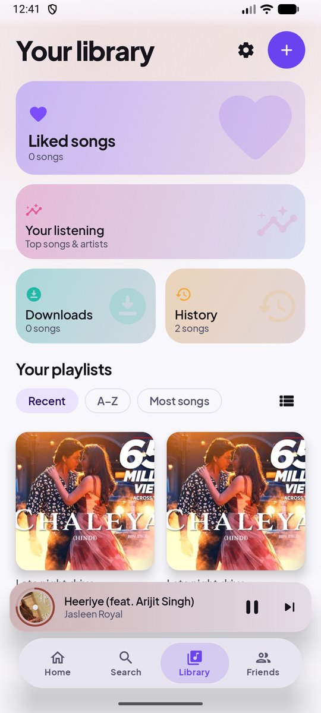
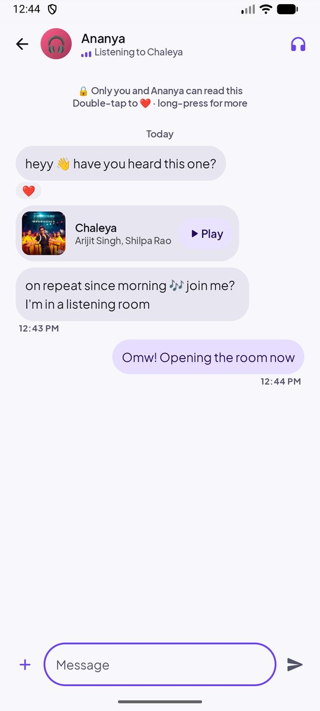
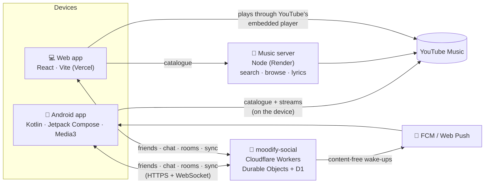

<div align="center">

# Moodify

**Music for every mood, shared with the friends who get it.**

Stream almost any song, find music by how you feel, sing along with synced lyrics, and listen together with friends. No phone number, no email, no ads.

[](https://github.com/khageshpatil/Moodify-v2/releases/latest)
[](https://github.com/khageshpatil/Moodify-v2/actions/workflows/android-release.yml)
[](https://moodify-v2-two.vercel.app)

[**⬇ Download for Android**](https://github.com/khageshpatil/Moodify-v2/releases/latest/download/Moodify.apk) · [**Open the web app**](https://moodify-v2-two.vercel.app) · [Privacy](https://moodify-v2-two.vercel.app/privacy)

<br />


&nbsp;

&nbsp;


</div>

---

## What it does

### 🎧 Listen
- **Almost any song.** The whole YouTube Music catalogue, played natively with a background service, lock-screen controls and a notification player.
- **Discover deck.** Swipe right to like, left to skip, with quick previews. Your personal picks are mixed with what's popular where you are.
- **Moods.** Chill, Focus, Energy, Romance, Party, Workout, Road trip, Heartbreak and Sleep, each one tap away.
- **Synced lyrics.** Lines light up karaoke-style. Lyrics in Hindi, Punjabi and other scripts come with romanisation, so you can sing along.
- **Made for you.** Quick picks from what you play most, "Because you like…" shelves, and endless autoplay radio when the queue runs out.
- **Offline.** Download songs, playlists or whole albums and play them without a connection.
- **A player that looks the part.** It takes its colours from the album art, with a draggable queue, loudness levelling, and light and dark themes.

### 💬 Friends, privately
- **A Moodify code instead of an account.** You get a code like `MOOD-4YZ2-8E6R` and 24 recovery words. There's no phone number, no email and no contacts upload. Add friends by code, link or QR.
- **Listening now.** See what friends are playing, live. Tap **Follow** to listen along in sync, or **Just play** to hear the song yourself.
- **Listen together.** Open a room, invite friends, and everyone hears the same moment. Hosts and DJs control the music, and the queue is shared.
- **Chat, end-to-end encrypted.** Send messages, songs and whole playlists, and react with a double-tap. Only you and your friend can read them, not even the server.
- **Profile pictures without photos.** Choose an emoji on a colour, or a "profile song" whose cover becomes your picture.
- **Your library everywhere.** Likes, playlists and history sync between your phone and the web, encrypted with your recovery words.

### 🌐 On the web too
The same app runs in any browser at **[moodify-v2-two.vercel.app](https://moodify-v2-two.vercel.app)**, with a full desktop player, lyrics, queue and keyboard shortcuts. Link it to your phone by scanning a QR code.

<p align="center"></p>

> On phones, browsers pause music when you leave the tab or lock the screen. For listening with the screen off, use the Android app.

## Screenshots

<table>
  <tr>
    <td align="center"><br /><sub><b>Home</b><br />Moods and the Discover deck</sub></td>
    <td align="center"><br /><sub><b>Now playing</b><br />Coloured by the artwork</sub></td>
    <td align="center"><br /><sub><b>Synced lyrics</b><br />With romanisation</sub></td>
    <td align="center"><br /><sub><b>Search</b><br />Top result, songs, albums, artists</sub></td>
  </tr>
  <tr>
    <td align="center"><br /><sub><b>Moods</b><br />Music for how you feel</sub></td>
    <td align="center"><br /><sub><b>Library</b><br />Liked, downloads, history, playlists</sub></td>
    <td align="center"><br /><sub><b>Friends</b><br />Listening now, live</sub></td>
    <td align="center"><br /><sub><b>Chat</b><br />End-to-end encrypted</sub></td>
  </tr>
</table>

## Install

**Android 7.0 or newer:**
1. Download **[Moodify.apk](https://github.com/khageshpatil/Moodify-v2/releases/latest/download/Moodify.apk)** from the latest release.
2. Open it, and allow installing from your browser if Android asks.
3. The app tells you when a new version is out and installs it for you.

**Web:** open [moodify-v2-two.vercel.app](https://moodify-v2-two.vercel.app). There's nothing to install.

## Privacy by design

| | |
|---|---|
| **No accounts** | Your identity is a key pair made on your device. The server only sees your code, name, picture and public keys. |
| **No tracking** | No ads, no analytics, no third-party trackers. |
| **Encrypted** | Messages and your synced library are end-to-end encrypted, so the server stores data it can't read. |
| **Not kept** | What you're listening to is shared live with friends only and never written to disk. Listening rooms disappear when they empty. |
| **Yours to delete** | Settings › Your Moodify code › Delete account removes everything from the server at once. |

The full details are in the [privacy page](https://moodify-v2-two.vercel.app/privacy). Friends features are for people aged 13 and older.

## How it works



- **Android** talks to YouTube Music directly from the phone, both for the catalogue and to play songs. That keeps it fast and lets it play in the background.
- **The web app** gets search, browse and lyrics from the music server, and plays songs through YouTube's embedded player.
- **moodify-social** is a separate Cloudflare Worker for everything social. Each user has a Durable Object holding their live connections and presence, and each listening room is one too. D1 stores accounts, friendships, encrypted messages and encrypted library records. It never receives a message it can read.

## Tech stack

| Part | Built with |
|---|---|
| Android | Kotlin, Jetpack Compose (Material 3), Media3/ExoPlayer, Room, WorkManager, OkHttp, Coil, BouncyCastle, Firebase Cloud Messaging |
| Web | React 18, TypeScript, Vite, React Router, WebCrypto |
| Music server | Node.js, `youtubei.js` |
| Social server | Cloudflare Workers, Durable Objects (WebSocket hibernation), D1 (SQLite), Workers Logs |
| Crypto | Ed25519 identities, X25519 + HKDF + AES-GCM messages, BIP-39 recovery words |
| Design | One token file (`design-tokens/moodify.tokens.json`) generates both the Android theme and the web CSS |

## Run it yourself

<details>
<summary><b>Android app</b></summary>

```bash
cd android
./gradlew :app:assembleDebug          # app/build/outputs/apk/debug/app-debug.apk
./gradlew :app:testDebugUnitTest      # unit tests
```

Debug builds talk to a local social server at `10.0.2.2:8790`. To use the live one, add `-PsocialBaseUrl=https://moodify-social.moodify-kp.workers.dev`. Release builds are signed by CI (`.github/workflows/android-release.yml`) and published as GitHub releases.
</details>

<details>
<summary><b>Web app</b></summary>

```bash
npm install
VITE_MOODIFY_SERVER_URL=http://127.0.0.1:8787 VITE_SOCIAL_URL=http://127.0.0.1:8790 npm run dev   # http://localhost:8080
npm test                              # unit tests
npm run typecheck
```

YouTube refuses embedded playback for many label songs on a bare `127.0.0.1` origin. Use `localhost` or a real domain when testing playback.
</details>

<details>
<summary><b>Music server</b></summary>

```bash
cd server
npm install
npm run dev                           # http://127.0.0.1:8787
npm test
```
</details>

<details>
<summary><b>Social server</b></summary>

```bash
cd social
npm install
npx wrangler d1 migrations apply moodify-social --local
npx wrangler dev --port 8790          # http://127.0.0.1:8790
npm test
```

Secrets go in `social/.dev.vars`: `SESSION_SECRET`, and optionally `FCM_SERVICE_ACCOUNT`, `VAPID_PUBLIC_KEY` and `VAPID_PRIVATE_KEY`. Merges to `main` deploy it automatically through Cloudflare Workers Builds.
</details>

## Project layout

```
android/          Android app (Compose UI in ui/, playback in player/, social in data/social/)
src/aura/         Web app (screens, player, social)
src/playback/     Web playback engines (YouTube embed + relay fallback)
server/           Music server: YouTube Music catalogue, search, lyrics
social/           Social server: identity, friends, chat, rooms, sync (Cloudflare Worker)
design-tokens/    Shared colours, type and spacing for Android and web
docs/             Design notes and protocol specs (docs/social-protocol/)
```

## Docs

- [Social and web design](docs/SOCIAL_AND_WEB_DESIGN.md): the plan behind the friends features
- Protocols:
  - [identity](docs/social-protocol/identity.md)
  - [friends](docs/social-protocol/friends.md)
  - [chat](docs/social-protocol/chat.md)
  - [listening rooms](docs/social-protocol/rooms.md)
  - [library sync](docs/social-protocol/sync.md)
  - [abuse limits and capacity](docs/social-protocol/limits.md)
- [Android changelog](docs/ANDROID_CHANGELOG.md)

---

<div align="center">
<sub>Moodify is an independent project and isn't affiliated with YouTube or Google. Music and artwork belong to their owners.</sub>
</div>
