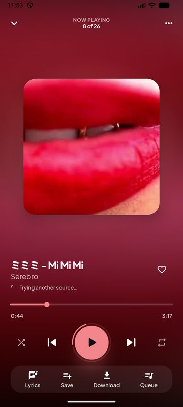
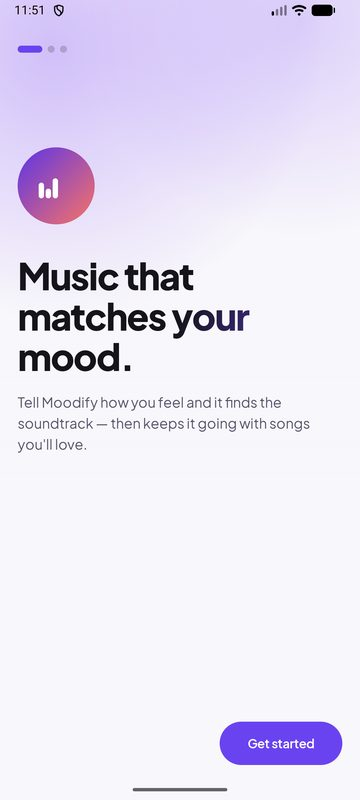
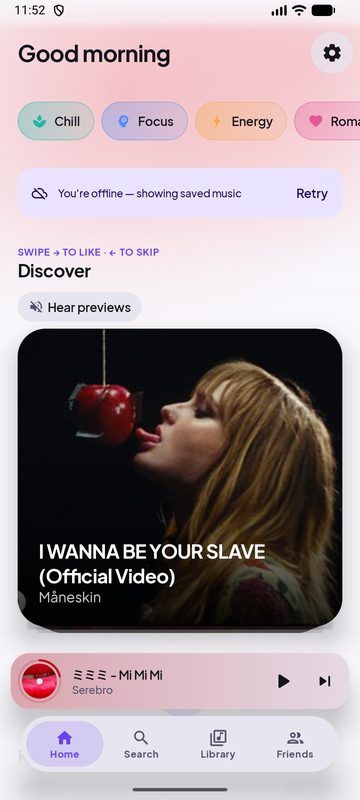
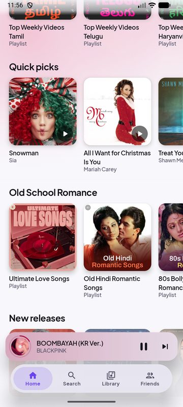

# Moodify: review and improvement plan

*November 2026. Written after a critical review of the whole project: the Android app, the web app, the music server and the social server.*

## How this review was done

I tried to find what's weak rather than confirm what works:
- **Code:** I read the code paths most likely to break.
- **Live measurements:** I timed the live web app on a simulated phone (CPU slowed 4×, a mobile connection) and timed the live music server from India.
- **Android:** I played, skipped and opened songs on the emulator and read the app's own logs.
- **Every screen:** I went through each screen as if Moodify were my own product.

The numbers below are measurements, not estimates, unless they say otherwise.

**Effort:** **S** = under half a day · **M** = 1–2 days · **L** = 3+ days.

## The verdict

Moodify is better than most hobby music apps.
- **What's strong:**
  - **The player:** beautiful, coloured by the artwork, with synced karaoke lyrics.
  - **The privacy model:** codes instead of accounts, and end-to-end encrypted chat and sync.
  - **Social features most apps don't have:** live "listening now", follow a friend, and listen-together rooms.
- **What's weak:**
  - **Start-up and song starts are slow.** That's the first impression.
  - **The first screen doesn't show what makes Moodify different.** It looks like a YouTube Music clone with a swipe deck on top.
  - **Inviting a friend dead-ends for anyone who doesn't already have the app.** That's the one moment growth depends on.

**The north star I'd steer by:** *Moodify is the music app for you and your closest friends.* Every screen should answer three questions quickly:
1. What should I play right now?
2. What are my friends playing?
3. How do I get back to what I was listening to?

---

## At a glance

| # | Phase | What | Why now |
|---|---|---|---|
| 0 | Only you | Rotate and back up the signing key, delete the stray worker and the test accounts | Risk you can't undo |
| 1 | Stop people leaving | Fast starts, a fast web app, invite links that work, honest states | First impressions |
| 2 | Music experience | Plays that count, skips that teach, cleaner art, data saver, synced web lyrics | Why people stay |
| 3 | UI/UX redesign pass | A friends-first Home, calmer visuals, fixes screen by screen | What makes Moodify feel like Moodify |
| 4 | Social | Request notifications, chat basics, moderation, shared playlists | The differentiator |
| 5 | Engineering health | CI tests, splitting big files, removing dead code, resilience to YouTube changes | Keeps the rest possible |
| 6 | Bigger bets | Recaps, shareable cards, Blend, group chats | Growth |

---

## Phase 0: things only you can do

| Task | Why |
|---|---|
| **Change the signing key passwords** and **back up** `android/moodify-release.jks` + `keystore.properties` somewhere safe and offline | The passwords were pasted into a chat. If the key is lost, installed phones can never update again. |
| **Delete the stray `moodify-v2` worker** in the Cloudflare dashboard | Leftover from the first deploy attempt. |
| **Approve deleting the 3 test accounts** (Ananya, Kabir, Meera) from the live database | They were left behind when the README screenshot session ended early. |
| **Decide on a license** (e.g. MIT) | The repo is public with no license, so nobody may legally reuse it. |
| **Decide when to move to Workers Paid ($5/month)** | The free plan tops out at roughly 50 daily active users ([limits.md](social-protocol/limits.md)). |

---

## Phase 1: stop people leaving (do first)

### 1.1 The music server rewrites an 18 MB file on every request: **S**
- **Evidence:** every search, Home or artist request re-saves the whole "discovery graph" (`server/data/discovery-graph.json`, 18 MB: 5,000 nodes and 15,000 edges) before answering. On a normal PC, parsing and re-writing it costs about 0.4 s. Render's free machine has a tenth of a CPU. The web app also downloads the graph on every visit (`/api/discovery/graph`: 1.3 MB compressed, 6.2 s measured).
- **Fix:**
  - Keep the graph in memory and save it at most every few minutes.
  - Stop sending it to browsers. The web recommendations can live without it, or get a small top-N summary.
  - Then re-measure Render. New searches currently take 3–5 s; I'd expect a clear drop, but haven't measured it yet.

### 1.2 Web app: about 9 seconds to first content on a phone: **M**
- **Evidence:** on a simulated mid-range phone, first content appeared at 7.3–9.3 s. The app is one 955 KB JavaScript file (289 KB compressed), which still includes the whole old "classic" app (about 90 component files, `/classic` route).
- **Fix:**
  - Delete `/classic` and its components and hooks.
  - Split by route (`React.lazy`).
  - Ask for cover images at the size shown: 544-px images currently fill 152-px tiles.
  - **Target:** content in under 3 s on the same test.

### 1.3 Web app: the browser is about 98% busy while a song plays: **S/M**
- **Evidence:** 98% main-thread time with the CPU slowed 4×, and about 80 layout passes a second while playing.
- **Causes:**
  - The whole player state, including the position updated 4× a second, sits in one React context, so every song row re-renders.
  - The "playing" bars animation changes `height`, which forces layout on every frame.
- **Fix:**
  - Put the position in its own small store, read only by the seek bar.
  - Memoise `TrackRow`.
  - Animate the bars with `transform: scaleY`.

### 1.4 Android: songs start slowly and sometimes never: **M**
- **Evidence (emulator):**
  - Opening a song from a link took 7–13 s to start (8 of 10). Two never started within 40 s.
  - Skipping to the next song took 2.7–5 s.
  - One song took 65 s to fail. It went through five stream "clients" in turn: login required, failed, failed, unplayable, then a 66-second decipher timeout. During all that the player only said "Trying another source…".
- **Fix:**
  - Give the whole resolution a time budget of about 10 s, with about 4 s per client.
  - Try the two best clients in parallel, and remember which one worked for the rest of the session.
  - If it fails: skip to the next song with a clear "Couldn't play X, skipped" (don't leave a spinner).
  - Keep pre-resolving the next song, which already exists, and check it on a real phone.
  - **Target:** under 2 s to first sound on a real phone.
- **Resilience:** the client order is hard-coded. Serve it as a small JSON file from moodify-social, so the next YouTube change can be fixed without shipping an APK.

### 1.4b Found while fixing (18 November): **S–M each**
- **Disk work on the main thread at start-up.** StrictMode flags `PlaybackManager`'s constructor (reached from `MainActivity.onCreate`) doing disk reads on the main thread. That's the likely cause of the "Moodify isn't responding" dialog seen on a cold start. Move that setup off the main thread.
- **Song links ignored while the app is open.** Opening `music.youtube.com/watch?v=…` links while Moodify was already running often did nothing: no resolution was even attempted in the logs. On 17 November the first 2 of 10 were ignored; on 18 November all 4 were. Check `onNewIntent` → `handleLink` → `openLink`.
- **Discover deck while loading.** The titles of the cards underneath show through the top card until its image loads, and the top card swaps to a different song a second later when fresh data arrives. Make the cards opaque, and don't reshuffle a deck the person can already see.
- **YouTube blocks by network.** On 18 November every stream client (13 of them) got "login required" or "unplayable" from the test machine's home connection. Both the emulator and the music server running locally were refused, though both had worked on 12 and 17 November. Most likely this connection was flagged after heavy automated testing, but it needs checking on a phone on another network. Either way it shows why 1.4's time budget, "skip and say so" and server-side client order matter.

### 1.5 Invite links do nothing for people without the app: **S/M**
- **Evidence:** "Share your code" sends `moodify://add/MOOD-…`. For someone without Moodify that link does nothing, and WhatsApp and SMS often don't even make it tappable.
- **Fix:**
  - Share `https://moodify-v2-two.vercel.app/add/MOOD-…` instead. The web page shows *"Ravi wants to be friends on Moodify"* with **Get the Android app** and **Open on the web** buttons.
  - Register it as an Android App Link, so it opens the app directly when installed.
  - Do the same for room and song links.

### 1.6 Every cold start flashes the welcome screens: **S**
- **Evidence:** the settings load asynchronously, and until they arrive "onboarding done" defaults to *false*. Each cold start (13.7 s on the emulator) shows the splash, then about 3 s of "Music that matches your mood", and only then Home.
- **Fix:** make the setting nullable ("loading") and keep the splash up until it's known. Also profile the cold start: it should be under 2 s on a real phone.

### 1.7 "You're offline" when you're not: **S**
- **Evidence:** Home shows *"You're offline — showing saved music"* when any one shelf times out, even though the network is fine.
- **Fix:** only say "offline" when Android's connectivity check says so. A slow shelf should quietly keep its cached copy.

### 1.8 Plays count before anyone listens: **S**
- **Evidence:** a play is recorded the moment a song loads, including on Android (`PlaybackManager`). After I skipped 8 songs after 6 seconds each, Home filled with "More like Psy" and "Keep listening: Barbie Girl, Chicken Song…".
- **Fix:** count a play after 30 s or half the song. Record quick skips as *negative* signals. Do the same on web.

---

## Phase 2: the music experience

| # | Change | Why | Effort |
|---|---|---|---|
| 2.1 | **Skips teach the recommender.** Down-rank artists you skip in under 15 s; don't seed "More like X" from them. | Recommendations currently learn the opposite of what you meant. | M |
| 2.2 | **Clean titles everywhere.** Strip "(Official Video)", "(Lyrical)", "\| T-Series", "Full Song", etc. Discover and catalogue shelves show raw video titles. | Looks like YouTube, not a music app. | S |
| 2.3 | **Better artwork.** Prefer square album art (YouTube Music song thumbnails) over video frames. For 16:9 frames, fill with a blurred copy instead of cropping heads. | Many cards show black bars or cut-off faces. | S/M |
| 2.4 | **Data saver** (Settings › Playback: Low / Normal / High). Mobile data matters in India; "Low" also starts faster. | Strong local need. | S |
| 2.5 | **Synced lyrics on the web.** The web shows plain text while Android is karaoke-style. Serve the same timed lyrics (LRCLIB) from the music server. | Parity and delight. | M |
| 2.6 | **Web remembers the song and queue** across a reload (Android already does). | Reloading loses your place. | S |
| 2.7 | **Search: load more results** on scroll (web only shows the first page). | Can't find deeper results. | S |
| 2.8 | **Crossfade and gapless** (Settings › Playback), then a simple equaliser. | Expected in a music app. | M |
| 2.9 | **Filter catalogue noise from Home:** YouTube's "Top Weekly *Videos* Tamil/Telugu/Haryanvi" charts, duplicate "Quick picks", seasonal leftovers (Christmas songs on Home in mid-November). Cap Home at 5–6 shelves. | Home is ~12 generic shelves long (below). | S |
| 2.10 | **Music server cache:** let the 10-minute keep-awake ping *force* a fresh Home (skip the cache and store the new answer), so visitors always get a cached Home; measure the cache in bytes, not characters. | Visitors still hit the slow path when Home expires between pings. | S |

---

## Phase 3: UI/UX design pass (as if it were my product)

### 3.1 Design direction
1. **Friends first, music always.** The social layer is what nobody else has, but on Android it's hidden in the 4th tab. Bring it to Home.
2. **One primary action per screen.** Right now Home shows two play buttons at once: the Discover deck's big one, and the mini player's.
3. **Calm by default, colourful when playing.** Tinting the whole app with the current cover's colour looks great in the player. On Home and Library it can turn everything muddy pink and hide the brand violet. Keep the tint for the player, the mini player and a soft header glow.
4. **Honest states.** Never a spinner for more than ~10 s. Always say what happened and what you can do.
5. **Text that reads like a friend.** Keep it short, and drop jargon: no "source", no "stream".

### 3.2 Android: screen by screen

**Home** (biggest change):

| Now | Proposed |
|---|---|
| Greeting, mood chips, a Discover deck filling the whole first screen, then "Keep listening" below the fold, then about 12 catalogue shelves. | 1. Greeting + mood chips (keep). 2. **Friends now**: a horizontal strip of friends' avatars, each with the cover of what they're playing; tap to Follow, Join or Message. If you have no friends yet: an "Invite a friend" card. 3. **Jump back in**: the last 6 songs/playlists as a compact 2-column grid. 4. **Discover** as one card at half its current height, or a "Discover" tile that opens the deck full screen. 5. At most 4–5 curated shelves (2.9). |
| Discover controls: ✕, queue, ▶, ♥ and a "1/30" counter squeezed into one row. | ✕ and ♥ (the swipe actions) plus one play button. Show the counter as dots, or drop it. |
| "Hear previews" toggle off by default, with a muted icon. | Keep it, but explain on first use: "Tap to hear 15-second previews". |

**Player** (already strong):
- Show a **lyrics preview line** under the artwork while lyrics exist; tap it to open full lyrics.
- Show **friends' context** when relevant: "Ananya played this yesterday", "Kabir is listening too".
- During resolution: show a thin progress line under the seek bar, never a spinner for more than 10 s (1.4).

**Friends:**
- **Collapse the "Your code" card** once you have a friend. Today it takes a large share of the screen on every visit; replace it with an "Add friend" button that opens a sheet with the QR and code.
- **"Former friend · VQR2"** rows look like bugs. Move old chats to an "Archived" row at the bottom, or remove them after 30 days.
- **Requests** get their own badge and a top section, which is good. Add a push notification for them (4.1).

**Chat:**
- Add sent / delivered / read ticks, a typing indicator, swipe-to-reply, delete for me, and long-press copy.
- Add a one-tap **"Send what I'm playing"** chip above the keyboard.
- Saving a shared playlist twice creates duplicates. Show "Saved ✓" based on whether the playlist already exists in your library, not just the button state.

**Library:**
- Hide empty tiles (e.g. "Liked songs · 0 songs" taking a large card) behind a single "Start liking songs" hint.
- Find and merge duplicate playlists ("Late night drive" ×2).

**Search:**
- The **Moods** grid repeats Home's mood chips. Use the space for **Genres & languages** (Bollywood, Punjabi, Tamil, Indie, Lo-fi…) and **Charts** instead.
- Recent searches should show the artwork of what you tapped, not just the text.

**Onboarding and getting a code:**
- The welcome screens are good. Add a final optional step: **"Listen with friends? Get your Moodify code"**.
- **Delay the 24 recovery words.** Show them when the person adds their first friend, or after 3 days, with a clear "Back up so you never lose your friends" reminder. Asking a new 15-year-old to copy 24 words on day one is the biggest drop-off risk in the social flow.
- **Say at code creation that "Share what I'm listening to" is on, and how to turn it off.** It is on by default and nothing mentions it.

**Settings:**
- Group into Account, Friends & privacy, Playback (data saver, crossfade, sleep timer), Appearance, About.
- Move "Advanced / diagnostics" to a hidden long-press on the version number.

### 3.3 Web
- **The tab title** still reads "MoodiFy KP - Your Personal Music Sanctuary". Use "Moodify", and the current song while one plays ("Kesariya · Moodify").
- **Phones:** playback pauses in the background (a browser limit with the YouTube player). On phones, make the web a **companion**: a top banner "Get the Android app for background play", with the Friends and Chat screens front and centre.
- **Desktop:** it's the web's best case. Add the **Discover deck** and personal shelves (Keep listening, More like…) for parity with Android, plus synced lyrics (2.5).
- **Getting a code on the web:** today it sits under "Settings" next to Appearance. Give Friends its own clear "Get your code / Link your phone" start.

### 3.4 Brand and visual consistency
- **One name and one mark** everywhere: "Moodify" (not "MoodiFy KP"), the same wave icon on Android, the web favicon and the README.
- **Contrast:** colours tinted from the artwork must keep text readable (the pink-on-pink cases). Enforce at least 4.5:1 for body text.
- **Spacing:** the mini player plus the bottom navigation take about a sixth of the screen on Android. A slimmer mini player (56 dp) and nav (64 dp) give content back.

---

## Phase 4: social

| # | Change | Why | Effort |
|---|---|---|---|
| 4.1 | **Push notification for friend requests and accepted requests** (today only messages wake the phone). | Requests sit unseen until the app is opened. | S |
| 4.2 | **Moderation you can act on.** Reports are stored but nothing reads them. Add a protected admin view (a secret-key endpoint or a tiny page) listing reports, plus auto-hiding an account after N reports from different people. | No way to act on abuse today. | M |
| 4.3 | **Chat basics:** read/delivered status, typing, reply, delete (3.2). | Expected in any chat. | M |
| 4.4 | **Chat history on a new device:** after linking or restoring, pull your own copies from the server (already stored for 30 days). | A new phone starts empty. | M |
| 4.5 | **Shared playlists:** a playlist two or more friends can add to, end-to-end encrypted like sync. | The social feature people ask for first. | L |
| 4.6 | **Rooms from anywhere:** a "Start a room" button on every friend's card and in chat; send the room invite to several friends at once. | Rooms are hard to find today. | S |
| 4.7 | **Presence controls:** "Hide from…" per friend, and "Pause sharing for 1 hour". | Privacy that feels personal. | S |
| 4.8 | **Groups (later):** small group chats of 3–10 people with a group room. | Natural next step. | L |

---

## Phase 5: engineering health

| # | Change | Why | Effort |
|---|---|---|---|
| 5.1 | **Run tests on every PR** with a GitHub Actions workflow: social (74 tests), music server (18), web (162 + typecheck), Android unit tests. | Nothing runs automatically before a merge today. | S |
| 5.2 | **Stop putting tokens in URLs.** Live connections pass the sign-in token as `?token=…`, and Workers Logs are on, so tokens may land in Cloudflare's logs. Send it via the `Sec-WebSocket-Protocol` header from both apps. The server already accepts that for the live connection; listening rooms need it added. Then stop accepting `?token=`. | Session tokens in logs. | S |
| 5.3 | **Split the four biggest Android files:** `PlaybackManager` (1,755 lines), `InnerTubeCatalogClient` (1,403), `MainViewModel` (1,368), `MainActivity` (1,266). Use per-screen view models, the navigation graph in its own file, and stream resolution separate from playback. | Easier to change safely. | L |
| 5.4 | **Remove dead code:** the web `/classic` app and its hooks and components; `worker/` (the old music worker); `spikes/`; `bun.lockb`; about 25 out-of-date `.md` files in the repo root. | About 30% less code to reason about. | S |
| 5.5 | **Server-controlled playback config** (1.4): the stream-client order and timeouts as JSON from moodify-social, read at app start. | Survive YouTube changes without an APK. | M |
| 5.6 | **Opt-in crash reports** to your own endpoint (no analytics, nothing personal). | Today you only hear about crashes from friends. | M |
| 5.7 | **Database safety:** check that D1 Time Travel (point-in-time restore) covers you, and write down how to restore. | One bad migration is unrecoverable otherwise. | S |
| 5.8 | **Test on real devices:** an Android phone (start times, background play, push), iPhone Safari (web), a 10-minute room with 2 phones and a browser, TalkBack. | All of the above was measured on an emulator or desktop. | M |

---

## Phase 6: bigger bets (after 1–4)

- **Weekly recap with friends:** "You and Ananya both played Chaleya 12 times this week". It runs on the device from local play stats, plus what friends choose to share.
- **Shareable song cards** for Instagram Stories and WhatsApp Status: the cover, the lyric line, and the invite link from 1.5. This is the cheapest growth loop available.
- **Blend:** a playlist mixing two friends' tastes. To protect privacy, each phone shares only its top artists, encrypted to that friend.
- **Android widget and Android Auto:** already on the roadmap.

---

## Not checked in this review

- Real phones; iPhone and Safari
- Rooms with real people over time
- TalkBack
- On Android, this round: the queue sheet, the track sheet, playlist detail and Your listening (stats). The emulator crashed under memory pressure.
- Load on Cloudflare itself, as opposed to local `wrangler dev`

## Appendix: measurements (14–17 November 2026)

| What | Result |
|---|---|
| Music server, new search from India | 3.0–5.2 s (24.5 s for the very first one after a deploy) |
| Music server, cached answer from India | ~0.9 s (network only) |
| Music server cache, live | 221 hits / 237 misses at the time of checking |
| Discovery graph file | 18 MB; parse 212 ms + write 184 ms per request on a normal PC |
| `/api/discovery/graph` to browser | 1.3 MB compressed, 6.2 s |
| Web, simulated phone: first content | 7.3–9.3 s; one 955 KB script; ~1 MB over 24 requests |
| Web while playing (CPU slowed 4×) | 98% main-thread busy; ~808 layouts per 10 s |
| Android (emulator), song from a link | 7–13 s to start (8/10); 2/10 not started in 40 s |
| Android (emulator), next song | 2.7–5.0 s |
| Android (emulator), worst failure | 65 s across 5 stream clients before giving up |
| Android (emulator), cold start | 13.7 s, including about 3 s of onboarding shown by mistake |
| Social server capacity, free plan | ~50 daily active users ([limits.md](social-protocol/limits.md)) |
